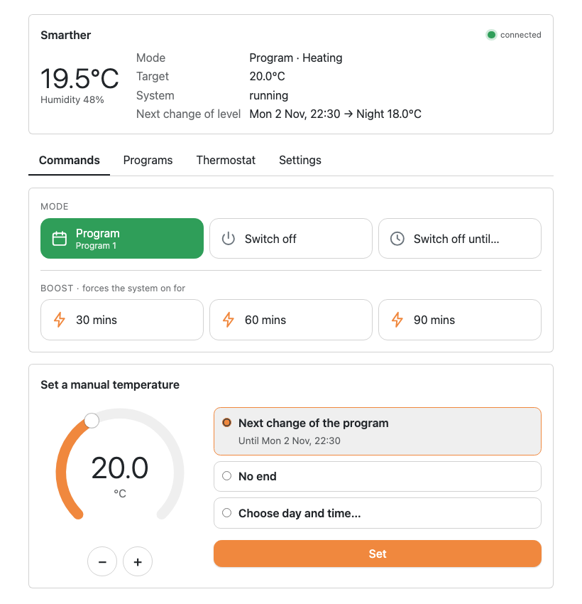
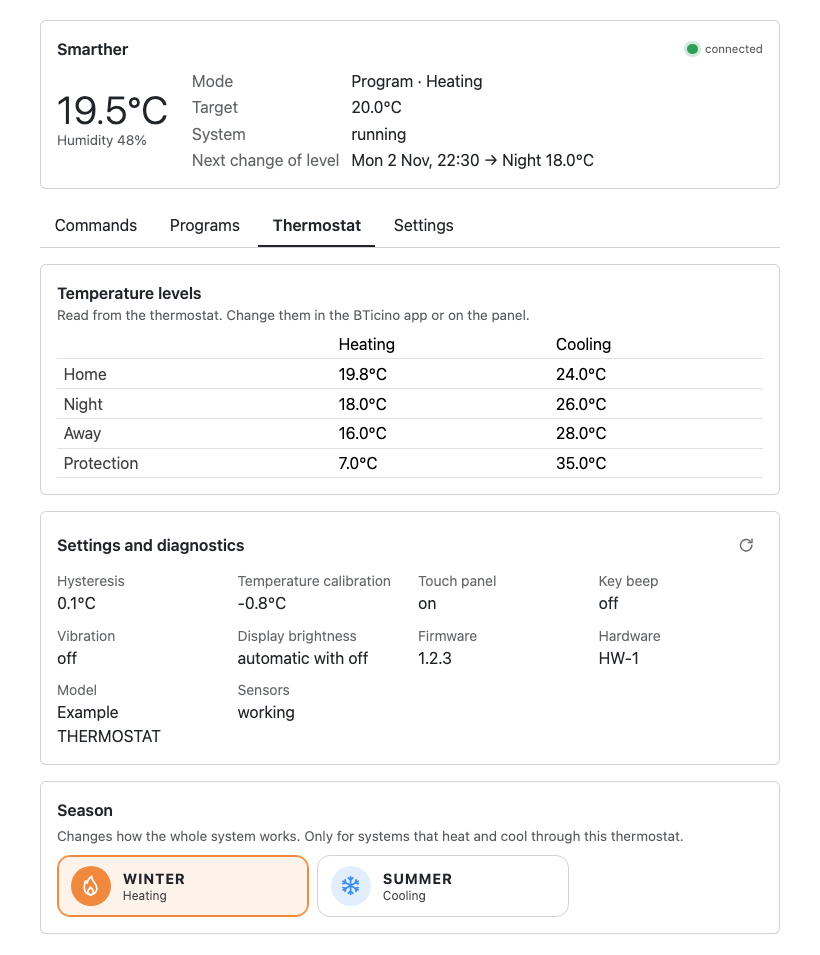

# Much Smarther Bridge

*[English](README.md)*

Porta il termostato BTicino Smarther **X8000** (prima generazione) in **Apple Casa**, con un plugin per Homebridge. Parla con il termostato sulla rete di casa, senza cloud durante il funzionamento, e si comporta il più possibile come l'app BTicino Thermostat.

> **Stato: prima versione, 0.1.0.** Verificato su un vero X8000 in riscaldamento, con Homebridge 2.5 su un Raspberry Pi 3, compresi riavvii e cadute di rete. Non è ancora su npm: installa il pacchetto allegato all'[ultima versione](https://github.com/iu5gal/much-smarther-bridge/releases/latest). Il raffrescamento è stato provato solo con il simulatore.

## Cosa ottieni

- **Nell'app Casa:** temperatura e umidità della stanza, temperatura impostata 7–40 °C, Spento, Caldo e Auto (il programma settimanale), interruttori Boost 30/60/90, e interruttori facoltativi per ogni programma e per "spento fino al prossimo cambio". Le modifiche fatte dal pannello o dall'app BTicino compaiono in pochi secondi.
- **Nella pagina di configurazione dell'interfaccia di Homebridge:** la password recuperata una volta dal tuo account BTicino, o scritta a mano; temperatura manuale o spento fino a un giorno e un'ora a scelta; la scelta del programma; la stagione; le impostazioni e la diagnostica del termostato.
- **Leggero e locale:** circa 10–15 MiB di memoria oltre a Homebridge, nessuna porta di rete sua, nessun abbonamento o servizio a pagamento.
- **43 lingue** per la pagina di configurazione e i nomi nell'app Casa.

| La pagina di configurazione: comandi | La pagina di configurazione: impostazioni del termostato |
| --- | --- |
|  |  |

*Immagini prese con il simulatore, in inglese: i valori non vengono da un impianto reale.*

## Documentazione

| | |
| --- | --- |
| [Installazione su Raspberry Pi](docs/it/installation.md) | Homebridge dai pacchetti Debian, poi il plugin |
| [Configurazione](docs/it/setup.md) | Indirizzo, password, opzioni |
| [Abbinamento](docs/it/pairing.md) | Aggiungere il bridge all'app Casa |
| [Funzioni e limiti](docs/it/features.md) | Cosa fa sul termostato ogni comando dell'app Casa |
| [Risoluzione dei problemi](docs/it/troubleshooting.md) | Messaggi del log e problemi comuni |
| [Sicurezza e privacy](docs/it/security.md) | Cosa sapere per usarlo in sicurezza |
| [Note sul protocollo](docs/it/protocol.md) | Il protocollo locale del termostato, in sintesi |
| [Contribuire](docs/it/contributing.md) · [Politica di sicurezza](SECURITY.md#italiano) | |

Documenti tecnici, in inglese: [riferimento del plugin](packages/homebridge-plugin/README.md), [protocollo](docs/PROTOCOL.md), [funzioni native](docs/FEATURES.md), [modello di sicurezza](docs/SECURITY-MODEL.md), [prove manuali](docs/TESTING.md), [registro delle modifiche](CHANGELOG.md).

## Requisiti

- Un BTicino Smarther X8000, prima generazione, configurato con l'app BTicino Thermostat. Il successivo Smarther2 with Netatmo è un prodotto diverso e non è supportato.
- Homebridge 1.8 o successivo (provato con 1.11 e 2.x) su un computer sempre acceso nella stessa rete, con Node.js 22, 24 o 26.
- Per recuperare la password del termostato: l'account BTicino a cui appartiene, o la password stessa.

## Da sapere

- **Windows: è tutto da provare.** Il codice lo prevede e i test automatici girano su Windows, ma il plugin non è mai stato usato con Homebridge su Windows. Le segnalazioni sono benvenute.

- **Un solo client locale.** Il termostato accetta una sola sessione locale, e la tiene il plugin. L'app BTicino continua a funzionare attraverso il cloud BTicino; senza internet, il termostato lo raggiunge solo l'app Casa.
- **I programmi settimanali** si creano e si modificano nell'app BTicino.
- **Nessun accesso remoto** suo: fuori casa usa l'app BTicino, oppure un hub domestico Apple.
- **Le traduzioni** sono state fatte con l'aiuto dell'intelligenza artificiale e non sono state tutte controllate da madrelingua. Le correzioni sono benvenute: vedi [Contribuire](docs/it/contributing.md#traduzioni).

## Contributi benvenuti

Segnalazioni di problemi, prove su altri sistemi (soprattutto Windows), correzioni e miglioramenti delle traduzioni sono accettati molto volentieri. Vedi [Contribuire](docs/it/contributing.md).

## Come è stato realizzato

Questo progetto è stato realizzato con il supporto di **Claude**, l'assistente di intelligenza artificiale di Anthropic, usato con Claude Code: progetto, codice, test, documentazione e traduzioni sono stati scritti con Claude, sotto la direzione e la revisione del manutentore, e verificati su un termostato reale. Le regole di lavoro del progetto per Claude sono in [CLAUDE.md](CLAUDE.md), in inglese.

## Struttura del repository

| Pacchetto | Scopo |
| --- | --- |
| `packages/core` | Client XOpen v3: connessione, autenticazione, parsing, modello di stato, comandi. Senza dipendenze da Homebridge. |
| `packages/homebridge-plugin` | `homebridge-much-smarther`, il plugin per Homebridge con la sua pagina di configurazione. |
| `packages/simulator` | Un finto termostato, per i test e le prove. |

```sh
npm ci
npm run hooks:install
npm run check
```

Leggi [Contribuire](docs/it/contributing.md) prima della tua prima modifica.

## Riconoscimenti

Il lavoro sul protocollo si è basato anche su [Mirmanero/ha-bticino-x8000](https://github.com/Mirmanero/ha-bticino-x8000), un'integrazione per Home Assistant dello stesso termostato. Grazie al suo autore. Non ne è stato copiato codice: questo progetto è implementato a partire dalle sue [note sul protocollo](docs/PROTOCOL.md).

## Licenza

[MIT](LICENSE). Copyright (c) 2026 iu5gal and contributors.

## Avvertenze

Questo è un progetto non ufficiale. Non è affiliato, approvato o supportato da BTicino o Legrand. "BTicino", "Smarther", "Apple Home", "HomeKit" e gli altri nomi sono marchi dei rispettivi proprietari e sono usati solo per descrivere la compatibilità.

Il recupero della password usa un servizio BTicino non ufficiale, che può cambiare o smettere di funzionare in qualsiasi momento; scrivere la password a mano resta sempre possibile.
