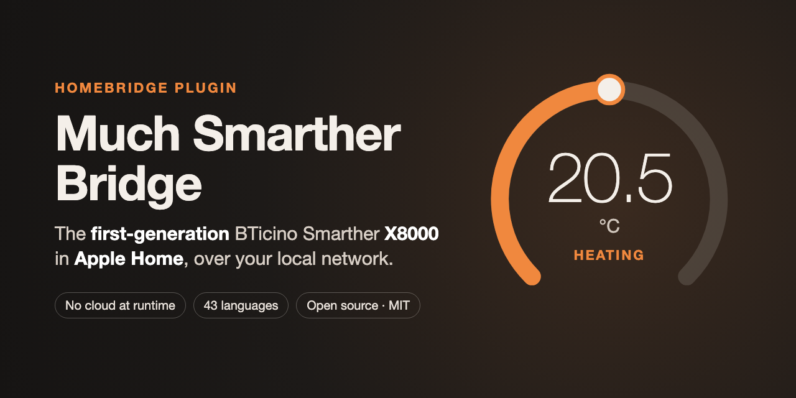
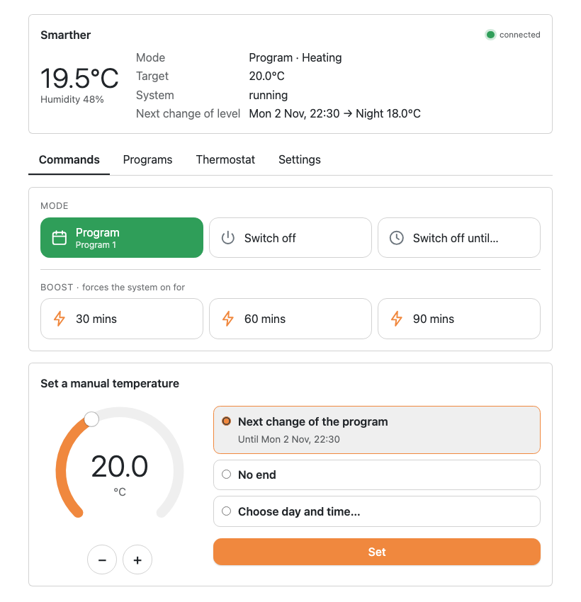
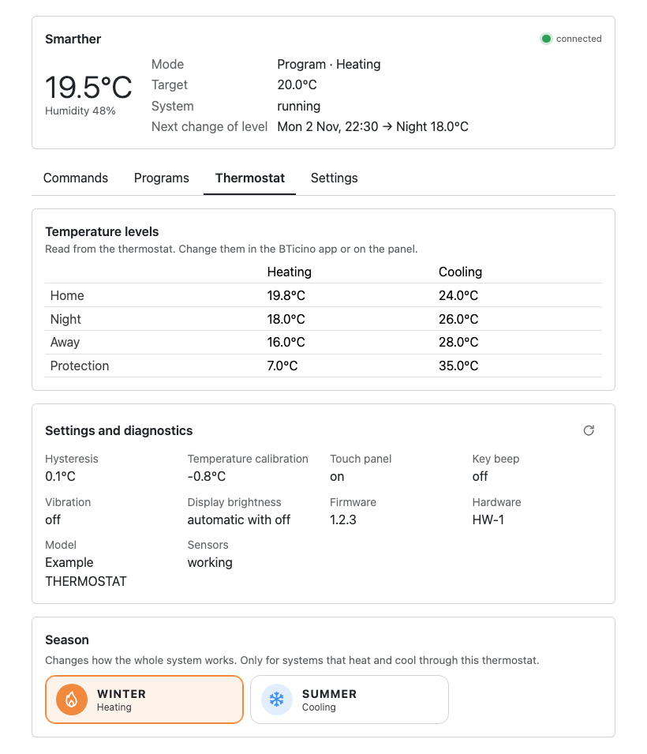

# Much Smarther Bridge

[](https://ko-fi.com/iu5gal)

> **Only for the first-generation Smarther, model X8000.** The later Smarther2 with Netatmo is a different product and is not supported.

Brings the **first-generation** BTicino Smarther thermostat, model **X8000**, into **Apple Home**, through a Homebridge plugin. It talks to the thermostat over your home network, with no cloud at runtime, and behaves as closely as possible to the BTicino Thermostat app.

> **Status: first release, 0.1.0.** Verified on a real X8000 in heating, with Homebridge 2.5 on a Raspberry Pi 3, including restarts and network drops. Not on npm yet: install the package attached to the [latest release](https://github.com/iu5gal/much-smarther-bridge/releases/latest). Cooling has only been tried with the simulator.

## What you get

- **In the Home app:** room temperature and humidity, target temperature 7–40 °C, Off, Heat and Auto (the weekly program), Boost 30/60/90 switches, and optional switches for each program and for "off until the next change". Changes made on the panel or in the BTicino app show up within seconds.
- **On the setup page in the Homebridge UI:** the password retrieved once from your BTicino account, or typed by hand; manual temperature or off until a chosen day and time; the choice of program; the season; the thermostat's settings and diagnostics.
- **Small and local:** about 10–15 MiB of memory on top of Homebridge, no network port of its own, no subscription or paid service.
- **43 languages** for the setup page and the Home app names.

| The setup page: commands | The setup page: thermostat settings |
| --- | --- |
|  |  |

*Screenshots taken with the simulator: the values are not from a real installation.*

## Documentation

| | |
| --- | --- |
| [Installation on a Raspberry Pi](docs/installation.md) | Homebridge from its Debian packages, then the plugin |
| [Setup and pairing](docs/setup.md) | Address, password, options, adding the bridge to the Home app |
| [Features and limitations](docs/features.md) | What each Home app control does on the thermostat |
| [Troubleshooting](docs/troubleshooting.md) | Log messages and common problems |
| [Security](SECURITY.md) | Running it safely, and reporting a vulnerability |
| [Plugin reference](packages/homebridge-plugin/README.md) | Settings in `config.json`, development |
| [Protocol notes](docs/PROTOCOL.md) · [Security model](docs/SECURITY-MODEL.md) · [Manual tests](docs/TESTING.md) | For developers |
| [Contributing](CONTRIBUTING.md) · [Changelog](CHANGELOG.md) | |

## Requirements

- A **first-generation** BTicino Smarther, model X8000, set up with the BTicino Thermostat app. Not the later Smarther2 with Netatmo.
- Homebridge 1.8 or later (tried with 1.11 and 2.x) on an always-on machine on the same network, with Node.js 22, 24 or 26.
- To retrieve the thermostat's password: the BTicino account it belongs to, or the password itself.

## Good to know

- **Windows: everything still has to be tried.** The code supports it and the automated tests run on Windows, but the plugin has never been used with Homebridge on Windows. Reports are very welcome.
- **One local client.** The thermostat accepts a single local session, and the plugin keeps it. The BTicino app keeps working through the BTicino cloud; without internet, only the Home app can reach the thermostat.
- **The weekly programs** are created and edited in the BTicino app.
- **No remote access** of its own: away from home, use the BTicino app, or an Apple home hub.
- **Translations** were made with AI assistance and have not all been checked by native speakers. Corrections are welcome: see [Contributing](CONTRIBUTING.md#translations).

## Contributions welcome

Bug reports, tests on other systems (Windows above all), fixes, and corrections to the translations are all gladly accepted. See [Contributing](CONTRIBUTING.md).

## Support

If the project is useful to you, you can support its development on [Ko-fi](https://ko-fi.com/iu5gal). Thank you!

## How it was made

This project was built with the support of **Claude**, Anthropic's AI assistant, used through Claude Code: the design, code, tests, documentation and translations were written with Claude, under the maintainer's direction and review, and verified on a real thermostat. The project's working rules for Claude are in [CLAUDE.md](CLAUDE.md).

## Repository layout

| Package | Purpose |
| --- | --- |
| `packages/core` | XOpen v3 client: connection, authentication, parsing, state model, commands. No Homebridge dependency. |
| `packages/homebridge-plugin` | `homebridge-much-smarther`, the Homebridge plugin and its setup page. |
| `packages/simulator` | A fake thermostat, for tests and trials. |

```sh
npm ci
npm run hooks:install
npm run check
```

See [Contributing](CONTRIBUTING.md) before your first change.

## Credits

Many thanks to [Mirmanero](https://github.com/Mirmanero) for [ha-bticino-x8000](https://github.com/Mirmanero/ha-bticino-x8000), the Home Assistant integration for the same thermostat: that work on the local protocol inspired this project and made it possible.

## License

[MIT](LICENSE). Copyright (c) 2026 iu5gal and contributors.

## Disclaimer

This is an unofficial project. It is not affiliated with, endorsed by or supported by BTicino or Legrand. "BTicino", "Smarther", "Apple Home", "HomeKit" and other names are trademarks of their respective owners and are used only to describe compatibility.

The password retrieval uses an unofficial BTicino service, which may change or stop working at any time; typing the password by hand always remains possible.
